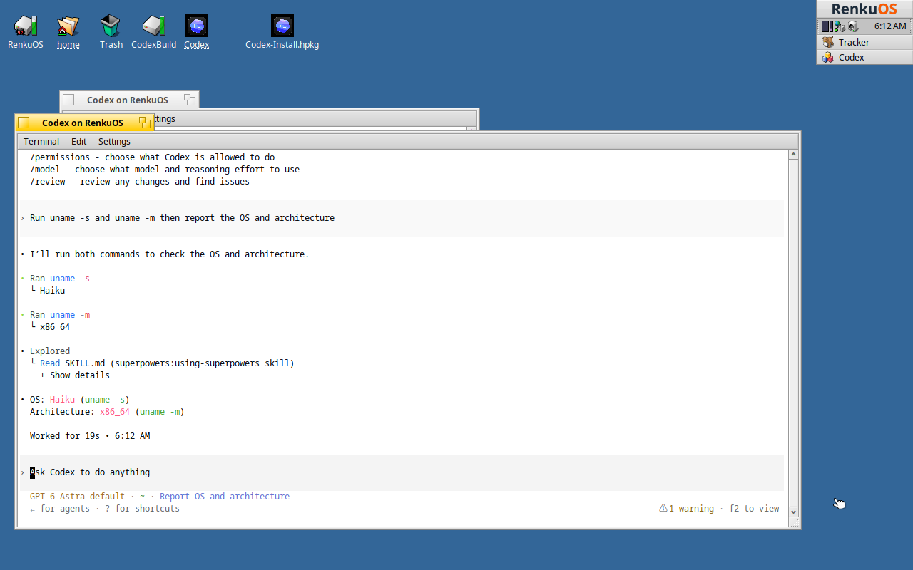

# Codex for RenkuOS

Experimental native x86-64 Codex CLI port for RenkuOS, the Haiku-based OS.
This community port is not an official OpenAI release.



The installed native build running on RenkuOS, showing a real shell command
and response. RenkuOS reports its Haiku foundation through `uname`.

## Quickstart on RenkuOS

1. Download the [x86-64 RenkuOS installer](https://github.com/chevydan6/codex-renkuos/releases/download/renkuos-v0.171.0-alpha.5-1/codex-renkuos-0.171.0-alpha.5-1-x86_64.hpkg).
2. Double-click the `.hpkg` on RenkuOS and follow the package installer.
3. Open **Applications → Codex**, or use a desktop shortcut to the installed launcher.
4. Read the no-sandbox warning and type `yes` if you agree to continue.

You can also install from Terminal:

```sh
pkgman install ./codex-renkuos-0.171.0-alpha.5-1-x86_64.hpkg
```

[All releases and checksums](https://github.com/chevydan6/codex-renkuos/releases).

The package includes a Terminal launcher, Codex icon, native CLI, code-mode
host, and dependency declarations. It does not include account credentials.

This version has **no native OS sandbox**. Each interactive launch warns you
and requires typing `yes` to continue. Normal command approvals still apply.

## Start from Terminal

```sh
/boot/system/apps/Codex/bin/codex
```

## Sign in

Use **Sign in with Device Code**, or run:

```sh
/boot/system/apps/Codex/bin/codex login --device-auth
```

Enable device code authorization in your ChatGPT security settings first.
Open the displayed link on a device with a browser, sign in using your usual
ChatGPT method, and enter the one-time code. Google-linked sign-in was tested
end to end on the development VM.

## Source and testing

Displayed version: `0.171.0-alpha.5`. The source is upstream Codex snapshot
`336b19ab26e0d4e36b16d8a21d668632cd800207` plus RenkuOS changes, not the exact
upstream alpha release tag. No kernel changes are required by this port.

- [Native build instructions](third_party/renkuos/README.md)
- [Stress-test report and limits](third_party/renkuos/STRESS-TEST-REPORT.md)
- [Installer notes](third_party/renkuos/package/README.md)

Two buffered native builds passed after repeated unbuffered compiler archive
failures. The compiler-only workaround is documented in the build notes; it
is not included in the app runtime. The underlying OS fault remains
undiagnosed. This experimental build has not had a security audit.

The upstream source license is [Apache 2.0](LICENSE). Individual bundled
components and artwork retain their respective notices and rights.
